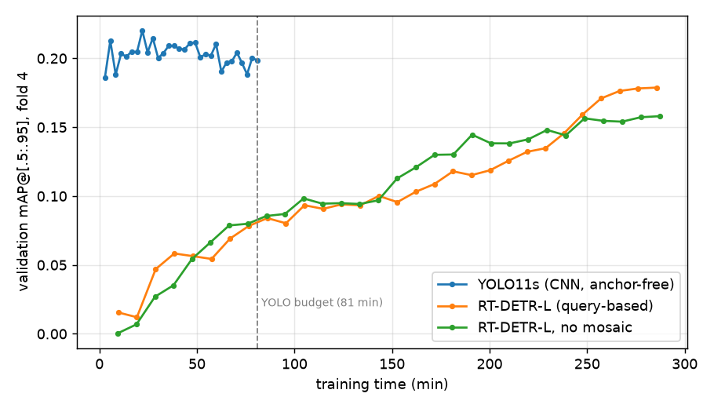

## 1. Task and evaluation

Detect 8 classes (person, bicycle, car, van, truck, tricycle, bus, motor) in drone video frames. Submissions list `class score x y w h` in pixels. All results below come from one scorer (`src/metric.py`): COCO mAP@[.5:.95] with up to 500 detections per image, ignored regions treated as crowd boxes for every class, scored on the original (unpainted) frames, using every 5th frame of the held-out clips. Inference speed is ms per image at batch 1 on an RTX 4050 Laptop (6 GB).

## 2. Data understanding and preprocessing

Code: `src/eda.py`, `src/prepare_data.py`, `src/folds.py`, `src/anchors.py`. Figures: `images/eda_*.png`, `images/gt_check.png`.

| Observation | Value | Decision it informed |
|---|---|---|
| Class balance | car 44%, person 31%, motor 9%, bus 0.8% | Report per-class AP; rare classes (bus, truck) are noisy |
| Box size at 1280 px width | p10 / p50 / p90 = 16 / 31 / 66 px | Train at 1280 px (at 640 px, 54% of boxes would be under 16 px) |
| COCO size share | small 24%, medium 64%, large 12% | Track AP_small separately |
| Objects per frame | median 42, p99 140, max 180 | 500 detections per image; RT-DETR's 300 queries are enough |
| Same-object IoU between frames | lag 1: 0.85, lag 5: 0.56, lag 10: 0.40 | Train on every 10th frame; adjacent frames are near-duplicates |
| Test widths | 680 to 1920 px | Keep frames at their native aspect ratio, letterboxed to 1280 |


**Preprocessing.** Every 5th frame is extracted. Ignored regions are painted grey (114), with labelled boxes restored on top, so the detector is not taught that unlabelled objects are background. Frames wider than 1920 px are downscaled. Annotations are converted to YOLO txt and COCO json from the same source. `images/gt_check.png` shows the converted boxes on sample frames.

**Validation design.** The 63 train+val clips come from 55 source videos. Five folds are split by source video, so clips cut from the same flight never appear on both sides (`folds/folds.csv`, seed 42). Fold 4 is the tuning fold. The best YOLO setup was re-checked on folds 1 and 2. Anchors were fitted only on fold 4's training clips.

## 3. Common protocol

Same frames, fold and input size for every family: 1280 px, COCO-pretrained weights, AMP, batch 4 where memory allows. YOLO and RT-DETR use Ultralytics 8.4 for 30 epochs, keeping the best epoch. Faster R-CNN and RetinaNet use torchvision 0.29 for 12 epochs (SGD lr 0.02×batch/16, warmup + cosine). Each experiment changes one thing from its family's baseline.

## 4. Two-stage anchor-based: Faster R-CNN (ResNet-50 FPN v2)

Code: `src/train_torchvision.py --arch frcnn`.

| Run | mAP | AP50 | AP_small | ms/img |
|---|---|---|---|---|
| Baseline (default anchors 32–512, Smooth L1) | 0.2168 | 0.414 | 0.040 | 97 |
| **Anchors from k-means (12–192 px)** | **0.2206** | **0.441** | **0.051** | 100 |
| GIoU box loss (weight 10) | 0.2146 | 0.412 | 0.043 | 98 |

K-means on box sizes (`results/anchors.json`) showed that 54% of boxes are below the default 32 px anchor. Smaller anchors raised AP50 by 0.027 and AP_small by 28%, but not AP75. The model finds more objects but does not localise them better. GIoU did not help at this weight.

**What each stage contributes.** The RPN turns about 200k anchors into 1,000–2,000 class-agnostic proposals, so recall is decided here. Smaller anchors therefore help small objects most. The second stage re-pools features for each proposal and refines class and box. That second refinement is why Faster R-CNN tolerates poorly matched anchors (see RetinaNet below) and has the best AP_large (0.439).

**Failure cases** (from per-class and per-size AP):
1. **Van vs car** (van AP 0.11 vs car 0.44). Seen from above, vans and cars differ mainly in length, and both are labelled in the same scenes. Classification, not localisation, is the likely error.
2. **Tiny people and bicycles** (AP_small 0.05). A 10–15 px person covers 2–4 cells of the stride-4 P2 map. A box that is off by 2 px drops below IoU 0.5, so detections count as false positives at the stricter thresholds.
3. **Rare large vehicles** (bus and truck have about 500–900 instances per fold). Scores swing by ±0.1 between runs, and a bus cut off at the image edge is often split into several boxes.

## 5. One-stage anchor-based: RetinaNet (ResNet-50 FPN v2)

| Run | Anchor size / stride | mAP | AP75 | AP_small | AP_large |
|---|---|---|---|---|---|
| **Baseline (32–512)** | 4× | 0.1874 | **0.178** | 0.040 | **0.397** |
| K-means anchors (12–192) | 1.5× | 0.1348 | 0.100 | 0.044 | 0.272 |
| Anchors 16–256 | 2× | 0.1625 | 0.137 | 0.046 | 0.327 |
| **Focal gamma 1.5** (default anchors) | 4× | **0.1885** | 0.177 | 0.042 | 0.401 |

The anchors that helped Faster R-CNN hurt RetinaNet badly, and the effect grows with anchor size relative to stride. RetinaNet starts at P3 (stride 8). With anchors only 1.5× the stride, a 200 px bus is assigned to P7 (stride 128). I simulated anchor matching on the training boxes: the median best-anchor IoU for 32–64 px boxes fell from 0.77 to 0.63. Matching an anchor set to box sizes (the data) is not enough; it must also match the feature strides (the model).

**Removing the proposal stage.** Without the RPN, the classifier sees every anchor: about 100k background anchors per frame against about 40 objects. Focal loss addresses this imbalance; changing gamma 2.0→1.5 made no difference (+0.001). The other loss is that boxes are never re-pooled and refined, so the anchor-to-object fit directly limits AP75. Fixes are better positive assignment (ATSS), a refinement step (Cascade RPN), or a stride-4 level for small objects. Tuned RetinaNet (0.1885) stays 0.032 below tuned Faster R-CNN (0.2206) and is only about 1.4× faster.

## 6. One-stage anchor-free: YOLO11s

**How locations are assigned.** No anchors exist: every grid cell on P3–P5 predicts distances to the 4 box sides. The Task-Aligned Assigner (TOOD) picks the top-10 cells per object by classification score × IoU, among cells whose centre falls inside the box. A 12 px object contains only about 2 cells at stride 8, and neighbouring objects in a dense car park compete for the same cells, which limits small and crowded objects.

**Search range** (fold 4, one change at a time, then combined):

| Run | mAP | AP50 | AP_small | AP_medium | AP_large |
|---|---|---|---|---|---|
| Baseline (auto AdamW lr 8.3e-4) | 0.2105 | 0.398 | 0.063 | 0.165 | 0.374 |
| Input 960 instead of 1280 | 0.1966 | 0.369 | 0.043 | 0.146 | 0.374 |
| P2 head (stride 4; batch 2 for memory) | 0.1982 | 0.394 | 0.048 | 0.168 | 0.342 |
| Loss: 0.5 CIoU + 0.5 NWD, C = 37 px | 0.2116 | 0.399 | 0.067 | 0.162 | 0.386 |
| Augmentation: scale 0.9, mixup 0.1 | 0.2172 | 0.413 | 0.068 | 0.171 | 0.370 |
| Every 5th frame, 15 epochs (same steps) | 0.2145 | 0.400 | 0.065 | 0.168 | 0.395 |
| Augmentation + NWD | 0.2309 | 0.426 | 0.074 | 0.181 | 0.388 |
| Augmentation + lr 3e-4 | 0.2316 | 0.430 | **0.078** | 0.184 | **0.427** |
| **Augmentation + lr 3e-4 + NWD** | **0.2403** | **0.434** | 0.069 | **0.191** | 0.417 |

NWD (Normalized Wasserstein Distance, `src/nwd.py`) is the loss modification. It treats boxes as Gaussians, so a few-pixel shift of a tiny box changes the loss smoothly instead of collapsing IoU. Alone it raised AP_small by 0.004. Combined with augmentation and a lower learning rate, it added 0.009 mAP. The baseline peaked at epoch 8 and then overfit (training loss falling while validation classification loss rose). Augmentation and the lower learning rate addressed that; denser frames did not, because they are near-duplicates. The P2 head failed: only 297 of 593 weight tensors loaded from the pretrained checkpoint, and memory forced batch 2.

**Check on other folds:**

| Fold | Baseline | Tuned | Gain |
|---|---|---|---|
| 4 (tuning) | 0.2105 | 0.2403 | +0.030 |
| 1 | 0.1984 | 0.2214 | +0.023 |
| 2 | 0.2351 | not finished | |

The gain holds on fold 1 but comes from medium and large objects. AP_small fell there (0.080 → 0.074). Against the anchor-based models, tuned YOLO beats tuned Faster R-CNN by 0.020 mAP and on AP_small (0.069 vs 0.051), but not on AP_large, at about 4.5× the speed.

## 7. Query-based: RT-DETR-L

Batch 4 at 1280 px ran out of memory, so RT-DETR used batch 2 (AdamW lr 1e-4, 30 epochs, 300 queries, Hungarian matching on cost weights class 2, L1 5, GIoU 2).

| Run | mAP | AP_small | AP_large | ms/img | Train time |
|---|---|---|---|---|---|
| Baseline | 0.1684 | 0.030 | 0.335 | 122 | 286 min |
| No mosaic | 0.1495 | 0.032 | 0.290 | 123 | 287 min |
| Loss: 0.5 GIoU + 0.5 NWD | not finished (code ready: `--nwd-ratio`) | | | | |



**Bipartite matching** assigns each ground-truth box to exactly one query, so duplicates are penalised during training and no NMS is needed. The cost is a slower, unstable early phase: matches change between iterations, and most of the 300 queries learn "no object". At YOLO's full budget (81 min), RT-DETR had reached about 0.07 validation mAP against YOLO's 0.22. **RT-DETR had not converged:** its best epoch was the last one, with a jump in the final 5 epochs. The jump also appears without mosaic, so it comes from the decaying learning rate rather than from switching mosaic off. On small objects it is the weakest model (AP_small 0.030). The encoder works at stride 8–32, and 300 queries must cover frames with up to 180 objects.

## 8. Pipeline, final selection and leaderboard

| Submission (trained on fold-4 training clips) | Local mAP, fold 4 | Public LB |
|---|---|---|
| YOLO11s baseline | 0.2105 | **0.2605** |
| YOLO11s augmentation + lr 3e-4 | 0.2316 | 0.2406 |

The local gain of +0.021 did not carry over to the public split (about 30% of test clips). Two causes are likely. Per-clip mAP on fold 4 ranges from 0.05 to 0.36, and random 30% subsets of clips moved the score by ±0.06. Also, the best epoch of that run (5) was chosen on the same clips it was scored on. Following the rules, the final choice is based on internal CV: the tuned configuration (better on 2 of 2 folds), with the baseline as the second, safer pick.

Not done before the deadline: ensembling YOLO with Faster R-CNN, test-time augmentation and tiling, temporal rescoring, and retraining on all clips. These are the planned next steps. The analysis points to small objects as the main gap, which favours tiling or higher resolution over more loss tuning.

## 9. How to run

```bash
python -m venv .venv && .venv/bin/pip install -r requirements.txt
ln -s multiple-object-video-detection-hw-2-ucu-ai-2026 data      # Kaggle data
python src/folds.py && python src/prepare_data.py                  # folds, frames, lists
python src/eda.py && python src/anchors.py --fold 4                # figures, anchors
python src/train_torchvision.py --name frcnn_anchors --arch frcnn --anchor-sizes 12,24,48,96,192
python src/train_ultralytics.py --name yolo11s_aug_lr_nwd --model yolo11s.pt --fold 4 \
    --nwd-ratio 0.5 --set scale=0.9 mixup=0.1 optimizer=AdamW lr0=0.0003
python src/predict_ultralytics.py --weights runs/yolo11s_aug_lr_nwd_fold4/weights/best.pt \
    --out submissions/final.csv
pytest tests
```

Every run appends its metrics to `results/experiments.csv`. The exact settings for each experiment are in `scripts/queue_*.sh`. Seed 42 everywhere; Ultralytics runs use `deterministic=True`.

## References

VisDrone (Zhu et al., 2021); Faster R-CNN (Ren et al., 2015); FPN (Lin et al., 2017); RetinaNet / focal loss (Lin et al., 2017); ATSS (Zhang et al., 2020); TOOD (Feng et al., 2021); YOLO11, Ultralytics (Jocher et al., 2024); RT-DETR (Zhao et al., 2024); NWD (Wang et al., arXiv:2110.13389); GIoU (Rezatofighi et al., 2019); YOLOv2 k-means anchors (Redmon & Farhadi, 2017). Libraries: PyTorch, torchvision, Ultralytics, pycocotools. Code was written with the help of an AI assistant (Claude); all experiments were run and checked locally.
