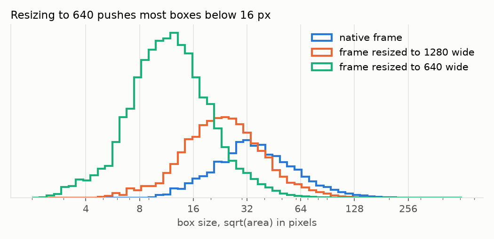

## 1. Task and evaluation

The task is to detect 8 classes (person, bicycle, car, van, truck, tricycle, bus, motor) in drone video frames. A submission lists `class score x y w h` in pixels for each frame. I scored everything with one script, `src/metric.py`: COCO mAP@[.5:.95], up to 500 detections per image, ignored regions treated as crowd boxes for every class, on the original (unpainted) frames, using every 5th frame of the held-out clips. Speed is ms per image at batch 1 on my RTX 4050 Laptop GPU (6 GB).

Every number in this report comes from a single training run with seed 42. I did not measure seed-to-seed variance, so I treat differences of a few thousandths of mAP as noise.

## 2. Data understanding and preprocessing

Code: `src/eda.py`, `src/prepare_data.py`, `src/folds.py`, `src/anchors.py`. Figures: `images/eda_*.png`, `images/gt_check.png`.

| Observation | Value |
|---|---|
| Class balance | car 44%, person 31%, motor 9%, bus 0.8% |
| Box size at 1280 px width (p10 / p50 / p90) | 16 / 31 / 66 px |
| COCO size share | small 24%, medium 64%, large 12% |
| Objects per frame | median 42, p99 140, max 180 |
| Same-object IoU between frames | lag 1: 0.85, lag 5: 0.56, lag 10: 0.40 |
| Test frame widths | 680 to 1920 px |



The box sizes mattered most. At 640 px input, 54% of boxes would be under 16 px, so I trained everything at 1280 px and tracked AP_small separately. The frame-to-frame IoU showed that adjacent frames are near-duplicates, so I trained on every 10th frame. With up to 180 objects per frame, I allowed 500 detections per image; RT-DETR's 300 queries are enough for that. Bus and truck are rare, so I report per-class AP and don't read much into their changes.

Preprocessing extracts every 5th frame. Ignored regions are painted grey (114), with labelled boxes drawn back on top, so the detector isn't taught that unlabelled objects are background. Frames wider than 1920 px are downscaled. YOLO txt and COCO json labels are both generated from the same source, and `images/gt_check.png` shows the converted boxes on sample frames.

The 63 train+val clips come from 55 source videos. I split five folds by source video, so clips cut from the same flight never end up on both sides (`folds/folds.csv`, seed 42). Fold 4 is the tuning fold. I re-checked the best YOLO setup on folds 1 and 2, and fitted anchors only on fold 4's training clips.

## 3. Common protocol

All families use the same frames, fold and input size: 1280 px, COCO-pretrained weights, AMP, and batch 4 where memory allows. YOLO and RT-DETR are trained with Ultralytics 8.4 for 30 epochs, keeping the best epoch. Faster R-CNN and RetinaNet are trained with torchvision 0.29 for 12 epochs (SGD, lr 0.02×batch/16, warmup + cosine). Each experiment changes one thing from its family's baseline.

## 4. Two-stage anchor-based: Faster R-CNN (ResNet-50 FPN v2)

Code: `src/train_torchvision.py --arch frcnn`.

| Run | mAP | AP50 | AP_small | AP_large | ms/img |
|---|---|---|---|---|---|
| Baseline (default anchors 32–512, Smooth L1) | 0.2168 | 0.414 | 0.040 | 0.429 | 97 |
| **Anchors from k-means (12–192 px)** | **0.2206** | **0.441** | **0.051** | **0.439** | 100 |
| GIoU box loss (weight 10) | 0.2146 | 0.412 | 0.043 | 0.424 | 98 |
| K-means anchors + 4,000 / 2,000 RPN proposals | 0.2185 | 0.438 | 0.050 | 0.432 | 140 |

The default anchors start at 32 px, but more than half the boxes are smaller than that (Section 2), so I fitted anchors with k-means (`results/anchors.json`). AP50 went from 0.414 to 0.441 and AP_small from 0.040 to 0.051, but AP75 didn't move, so the extra detections aren't better localised. GIoU at weight 10 didn't help. I also doubled the RPN proposals, since some frames have 180 objects. That made no difference and was 40% slower. The best epoch was 4 of 12, so longer training wasn't worth trying.

In this model, recall is decided in the RPN, which turns about 200k anchors into 1,000–2,000 class-agnostic proposals. That is why smaller anchors help small objects most. The second stage re-pools features for each proposal and refines the class and box. This lets Faster R-CNN tolerate anchors that fit the objects poorly, unlike RetinaNet below, and probably explains its high AP_large.

Failure cases, from the per-class and per-size AP:

1. Vans are confused with cars (van AP 0.11, car 0.44). From above, the two differ mainly in length, and both appear in the same scenes. I think this is a classification error rather than a localisation one.
2. Tiny people and bicycles (AP_small 0.05). A 10–15 px person covers 2–4 cells of the stride-4 P2 map. A 2 px offset already drops such a box below IoU 0.5, so it counts as a false positive at the stricter thresholds.
3. Rare large vehicles. Bus and truck have only about 500–900 instances per fold, and their AP swings by ±0.1 between runs. A bus cut off at the image edge is often split into several boxes.

## 5. One-stage anchor-based: RetinaNet (ResNet-50 FPN v2)

| Run | Anchor size / stride | mAP | AP75 | AP_small | AP_large | ms/img |
|---|---|---|---|---|---|---|
| **Baseline (32–512)** | 4× | 0.1874 | **0.178** | 0.040 | 0.397 | 68 |
| K-means anchors (12–192) | 1.5× | 0.1348 | 0.100 | 0.044 | 0.272 | 69 |
| Anchors 16–256 | 2× | 0.1625 | 0.137 | **0.046** | 0.327 | 69 |
| **Focal gamma 1.5** (default anchors) | 4× | **0.1885** | 0.177 | 0.042 | **0.401** | 69 |

I expected the k-means anchors to help RetinaNet as they helped Faster R-CNN. Instead, mAP fell from 0.187 to 0.135. A middle setting (16–256) landed in between, so the damage grows as the anchors shrink relative to the stride. RetinaNet starts at P3 (stride 8), and with anchors only 1.5× the stride, a 200 px bus is assigned to P7 (stride 128). I simulated anchor matching on the training boxes to check this. The median best-anchor IoU for 32–64 px boxes fell from 0.77 with the default anchors to 0.63 with the k-means ones. So an anchor set has to fit both the box sizes and the feature strides.

Without a proposal stage, the classifier sees every anchor: about 100k background anchors per frame against about 40 objects. Focal loss handles this imbalance, and changing gamma from 2.0 to 1.5 made no real difference (+0.001). Boxes are also never re-pooled and refined, so the anchor-to-object fit directly limits AP75. Better positive assignment (ATSS), a refinement step (Cascade RPN) or a stride-4 level for small objects would be the next things to try. Tuned RetinaNet (0.1885) ends 0.032 below tuned Faster R-CNN (0.2206) and is only about 1.4× faster (69 vs 100 ms).

## 6. One-stage anchor-free: YOLO11s

YOLO has no anchors. Every grid cell on P3–P5 predicts distances to the four box sides. The Task-Aligned Assigner (TOOD) picks the top-10 cells per object by classification score × IoU, among cells whose centre falls inside the box. A 12 px object contains only about 2 cells at stride 8, and in a dense car park neighbouring objects compete for the same cells. This limits small and crowded objects.

Search on fold 4, one change at a time, then combined:

| Run | mAP | AP50 | AP_small | AP_medium | AP_large | ms/img |
|---|---|---|---|---|---|---|
| Baseline (auto AdamW lr 8.3e-4) | 0.2105 | 0.398 | 0.063 | 0.165 | 0.374 | 22 |
| Input 960 instead of 1280 | 0.1966 | 0.369 | 0.043 | 0.146 | 0.374 | 14 |
| P2 head (stride 4; batch 2 for memory) | 0.1982 | 0.394 | 0.048 | 0.168 | 0.342 | 32 |
| Loss: 0.5 CIoU + 0.5 NWD, C = 37 px | 0.2116 | 0.399 | 0.067 | 0.162 | 0.386 | 22 |
| Augmentation: scale 0.9, mixup 0.1 | 0.2172 | 0.413 | 0.068 | 0.171 | 0.370 | 22 |
| Every 5th frame, 15 epochs (same steps) | 0.2145 | 0.400 | 0.065 | 0.168 | 0.395 | 22 |
| Augmentation + NWD | 0.2309 | 0.426 | 0.074 | 0.181 | 0.388 | 22 |
| Augmentation + lr 3e-4 | 0.2316 | 0.430 | **0.078** | 0.184 | **0.427** | 22 |
| **Augmentation + lr 3e-4 + NWD** | **0.2403** | **0.434** | 0.069 | **0.191** | 0.417 | 22 |

The baseline peaked at epoch 8 and then overfit: training loss kept falling while validation classification loss rose. I tried stronger augmentation and a lower learning rate to deal with this, and also denser frames. The first two helped; denser frames didn't, which fits the frames being near-duplicates.

NWD (Normalized Wasserstein Distance, `src/nwd.py`) is my loss modification. It models boxes as Gaussians, so shifting a tiny box by a few pixels changes the loss smoothly instead of collapsing the IoU. On its own it raised AP_small by only 0.004, which is within noise. Combined with augmentation and the lower learning rate it added 0.009 mAP.

The P2 head didn't work. Only 297 of 593 weight tensors loaded from the pretrained checkpoint, and memory forced batch 2, so the comparison isn't really fair to it.

Check on other folds:

| Fold | Baseline | Tuned | Gain |
|---|---|---|---|
| 4 (tuning) | 0.2105 | 0.2403 | +0.030 |
| 1 | 0.1984 | 0.2214 | +0.023 |
| 2 | 0.2351 | 0.2559 | +0.021 |

The gain holds on all three folds, which makes me fairly confident it isn't tuning noise. It comes from medium and large objects; for example, truck AP on fold 2 went from 0.16 to 0.24. AP_small actually fell on folds 1 and 2 (0.080 → 0.074 and 0.156 → 0.142). Tiling (Section 8) is meant to close that gap. Compared with the anchor-based models, tuned YOLO beats tuned Faster R-CNN by 0.020 mAP and on AP_small (0.069 vs 0.051), but not on AP_large, and it runs about 4.5× faster (22 vs 100 ms).

## 7. Query-based: RT-DETR-L

Batch 4 at 1280 px ran out of memory, so RT-DETR used batch 2 (AdamW lr 1e-4, 30 epochs, 300 queries, Hungarian matching with cost weights class 2, L1 5, GIoU 2).

| Run | mAP | AP_small | AP_large | ms/img | Train time |
|---|---|---|---|---|---|
| Baseline | 0.1684 | 0.030 | 0.335 | 122 | 286 min |
| No mosaic | 0.1495 | 0.032 | 0.290 | 123 | 287 min |
| **Loss: 0.5 GIoU + 0.5 NWD** | **0.1766** | **0.036** | 0.330 | 127 | 290 min |


Bipartite matching assigns each ground-truth box to exactly one query. Duplicates are penalised during training, and no NMS is needed. The price is a slow, unstable start: matches change between iterations, and most of the 300 queries learn "no object". When YOLO had finished its whole run (81 min), RT-DETR was at about 0.07 validation mAP against YOLO's 0.22.

RT-DETR had not converged. Its best epoch was the last one, after a jump in the final 5 epochs. The jump also appears without mosaic, so I attribute it to the decaying learning rate rather than to mosaic being switched off. NWD helped here too (+0.008 mAP, AP_small 0.030 → 0.036, AP_large unchanged). That is the same small-object pattern as in YOLO, which suggests the loss change carries over to other detector families, though it rests on one run per family. On small objects RT-DETR is still the weakest model: its encoder works at stride 8–32, and 300 queries have to cover frames with up to 180 objects.

## 8. Pipeline, final selection and leaderboard

For the final model, I retrained the tuned YOLO (augmentation + lr 3e-4 + NWD) on all 63 clips (2,734 frames, `--all-clips`). With no clips left for picking an epoch, I kept the 30-epoch schedule and stopped after epoch 14; on the three folds the best epochs had been 10, 14 and 15.

Inference-time methods (`src/inference_tests.py`, `src/fusion.py`; fold-4 models, scored on fold 4):

| Method | mAP | AP75 | AP_small | AP_large |
|---|---|---|---|---|
| Tuned YOLO, plain | 0.2403 | 0.232 | 0.069 | 0.417 |
| + horizontal flip (TTA), fused | 0.2522 | 0.245 | 0.073 | 0.430 |
| Ultralytics TTA (flip + 0.83×, 0.67× scales) | 0.2527 | 0.243 | 0.071 | 0.438 |
| + 2×2 tiles (20% overlap, each upscaled to 1280), fused | 0.2589 | 0.250 | 0.080 | 0.437 |
| YOLO + Faster R-CNN (2:1) | 0.2640 | 0.251 | 0.073 | 0.482 |
| YOLO + Faster R-CNN + RetinaNet (2:1:1) | 0.2664 | 0.255 | 0.074 | 0.491 |
| YOLO + Faster R-CNN + RT-DETR (2:1:1) | 0.2617 | 0.248 | 0.066 | 0.478 |
| **YOLO + flip + tiles + Faster R-CNN + RetinaNet (2:2:2:1:1)** | **0.2763** | **0.269** | **0.084** | **0.494** |

I merge sources with weighted box fusion (WBF). Overlapping same-class boxes are averaged, weighted by score, instead of all but one being dropped as in NMS. In dense scenes the IoU threshold matters a lot. At the usual 0.55, fusing YOLO with itself lost 0.010 mAP, because it merged neighbouring cars that YOLO's own NMS (IoU 0.65) had kept apart. At 0.65, self-fusion reproduces the plain score exactly, so I used 0.65 everywhere. Tile boxes touching an inner tile edge are dropped as cut-off objects.

The sources help in different places. Each tile covers 0.6 of the frame in each direction, so objects appear about 1.7× larger, and AP_small rises by 0.011. Flip mostly improves AP75. Faster R-CNN brings the best large-object boxes (AP_large +0.065). Adding RT-DETR made the ensemble worse, because its small-object predictions are weaker than everything else. I chose all the weights on fold 4, so the +0.036 gain there is somewhat optimistic.

Submissions:

| Submission | Local mAP, fold 4 (same setup) | Public LB |
|---|---|---|
| YOLO11s baseline (folds 0–3) | 0.2105 | 0.2605 |
| YOLO11s augmentation + lr 3e-4 (folds 0–3) | 0.2316 | 0.2406 |
| Tuned YOLO11s, all clips | 0.2403 | 0.2415 |
| **Five-source WBF ensemble** (`ens_all5.csv`) | **0.2763** | **0.2678** |

My two picks for the private leaderboard:

1. `ens_all5.csv` (main). Test frames go through the all-clips YOLO three times (full frame, horizontal flip, 2×2 tiles), plus the fold-4 Faster R-CNN (k-means anchors) and RetinaNet (focal gamma 1.5) checkpoints. All five are fused with WBF at weights 2:2:2:1:1 and IoU 0.65, keeping the top 500 boxes per frame. It is the best both locally and on the public board, and the ensemble gain is similar on both: +0.036 locally and +0.026 publicly over the all-clips YOLO alone. The cost is 6 YOLO passes (full, flip, 4 tiles) plus one Faster R-CNN and one RetinaNet pass per frame. From the single-model timings that is about 0.3 s per frame on my GPU, against 22 ms for YOLO alone.
2. `yolo11s_base_fold4.csv` (backup). The plain YOLO11s baseline is a single model with the second-best public score. Its public score is 0.05 above its local score, and no other submission has a gap like that. Per-clip mAP ranges from 0.05 to 0.36, and random 30% subsets of fold-4 clips moved mAP by ±0.06. My reading is that the public subset happens to favour this model, not that it is better, so I kept it only as the backup.

The all-clips retrain alone gave no public gain over the fold-4 model (0.2415 vs 0.2406).

Not done: temporal rescoring across neighbouring frames, and Grad-CAM/W&B. Temporal rescoring would be my next step. Objects persist across frames (IoU 0.85 at lag 1), so it could rescue weak small-object detections.

## 9. How to run

```bash
python -m venv .venv && .venv/bin/pip install -r requirements.txt
ln -s multiple-object-video-detection-hw-2-ucu-ai-2026 data      # Kaggle data
python src/folds.py && python src/prepare_data.py                  # folds, frames, lists
python src/eda.py && python src/anchors.py --fold 4                # figures, anchors
python src/train_torchvision.py --name frcnn_anchors --arch frcnn --anchor-sizes 12,24,48,96,192
python src/train_ultralytics.py --name yolo11s_aug_lr_nwd --model yolo11s.pt --fold 4 \
    --nwd-ratio 0.5 --set scale=0.9 mixup=0.1 optimizer=AdamW lr0=0.0003
python src/train_torchvision.py --name retina_focal --arch retina --focal-gamma 1.5
# final model on every clip, then the five test sources and the fused submission
python src/train_ultralytics.py --name yolo11s_aug_lr_nwd --model yolo11s.pt --all-clips --stop-epoch 14 \
    --nwd-ratio 0.5 --set scale=0.9 mixup=0.1 optimizer=AdamW lr0=0.0003 val=False
export PYTHONPATH=src; R="--run runs/yolo11s_aug_lr_nwd_all --weights last.pt"
for m in plain flip tile; do python src/predict_test.py $R --mode $m; done
python src/predict_test.py --run runs/frcnn_anchors_fold4 && python src/predict_test.py --run runs/retina_focal_fold4
python src/predict_test.py --fuse yolo11s_aug_lr_nwd_all yolo11s_aug_lr_nwd_all_tile yolo11s_aug_lr_nwd_all_flip \
    frcnn_anchors_fold4 retina_focal_fold4 --fuse-weights 2 2 2 1 1 --out submissions/ens_all5.csv
python src/inference_tests.py tile --weights runs/yolo11s_aug_lr_nwd_fold4/weights/best.pt   # fold-4 checks
pytest tests
```

Every run appends its metrics to `results/experiments.csv`, and public scores are in `results/public_scores.csv`. The exact settings for each experiment are in `scripts/queue_*.sh`. Seed 42 is used everywhere, and Ultralytics runs use `deterministic=True`.
